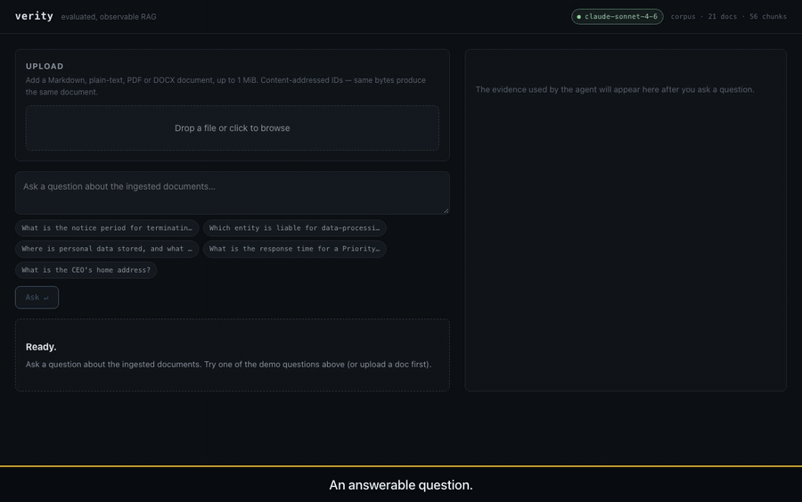

<div align="center">

# Verity

**Question answering over documents that cites the exact passage or refuses.**
A retrieval-augmented generation (RAG) agent: each quote is copied verbatim from its
source, and each published number traces to the run artefact that produced it.

[](https://github.com/matteogallo-ai/verity/actions/workflows/ci.yml)
[](https://scorecard.dev/viewer/?uri=github.com/matteogallo-ai/verity)
[](LICENSE)


</div>

<p align="center">
  
  <br>
  <sub>Live recording on the demo corpus (agent <code>claude-sonnet-4-6</code>): a cited
  answer, then an out-of-corpus question refused. Waits for the model are sped up; the
  real latency and cost of each answer are in
  <a href="docs/media/demo-run.json"><code>demo-run.json</code></a>.
  Two-minute walkthrough with the traces: <a href="docs/media/verity-demo.mp4">MP4</a>.</sub>
</p>

## What it is

Enterprise RAG demos answer confidently and are wrong just often enough to be
dangerous. Verity drafts an answer, checks deterministically that its citations cover
and match it, asks a scorer model how well the evidence supports it, and refuses when
a check fails or the scorer refuses. A score threshold exists but is 0 by default, so
it refuses nothing; the cited-relevance check is off by default (it made more wrong
refusals than right ones on dev, [measured](docs/results.md#refusal-checks-one-at-a-time)).
The evaluation corpus is small: 21 fictional documents of one invented company (contracts,
HR policies, finance), 5,489 words in all ([corpus](datasets/CORPUS.md)).

## Key result

<!-- KEY-RESULT:START -->
**Unanswerable questions answered: Verity 4/31, naive RAG 12/31** (lower is better; the naive arm has the same retrieval and synthesis and no checks): 93 questions (dev + test) that both arms completed, exact McNemar, Holm-adjusted p 0.023, [pre-registered](docs/preregistration/two-arm-comparison.md) before the runs.
**Invented answers 1/40** (Wilson 95% CI [0.004, 0.129]): answers holding a claim the judge finds unsupported by the retrieved passages, over every judged answer, answerable or not (`q-089`); all 40 shipped answers were judged. Faithfulness to the passages; correctness against the reference answers is graded separately in the results. Judge prompt v0.2.0 κ 0.60 vs blind human on 52 of 60 claims (its rejudge stopped at its spending cap; no bootstrap interval).
**Refusal recall 0.722**: 13/18 unanswerable questions refused, Wilson 95% CI [0.491, 0.875], at refusal precision 0.929 (13/14, CI [0.685, 0.987]).
One live run on the held-out `test` split, n = 54 of 56 completed (2 not run, stopped by the run's spending cap; 0 errored), agent `claude-sonnet-4-6`, commit `513b839`. Every metric, the judge's validation and the limits: [`docs/results.md`](docs/results.md).
4/31 does not compare directly with 13/18 refused or 1/40 invented: it pools dev and test and counts a self-abstention (an answer saying the documents do not hold it) as a refusal, by the [self-abstention rule](docs/preregistration/two-arm-comparison.md#metrics); the other two are the test split of the same runs alone (commit `513b839`), where a self-abstention counts as an answer.
<!-- KEY-RESULT:END -->

The comparison with the naive RAG baseline in full, with its power and decision rule:
[comparison](docs/results.md#verity-against-a-naive-rag-baseline-95-questions).
What the numbers do not say: [open issues](docs/results.md#open-issues-what-the-numbers-do-not-say).

## Quickstart

```bash
git clone https://github.com/matteogallo-ai/verity && cd verity
uv sync --dev                              # Python 3.12; CPU-only torch on Linux
VERITY_STORE=memory uv run verity eval run --ci  # pipeline smoke test on stubs, no database
make demo                                  # pgvector + API :8000 + Next.js :3000, stub agent
```

The first run downloads the embedding and reranker models (~200 MB) into the
Hugging Face cache. `make demo` needs Docker (for pgvector), Node 22 and corepack, and
runs the stub agent even when `.env` holds a provider key.

### Démo CCT en local

```bash
make demo-cct CORPUS=chemin/vers/le/dossier/de/la/cct           # agent stub, gratuit (LIVE=0 aussi)
make demo-cct CORPUS=chemin/vers/le/dossier/de/la/cct LIVE=1    # modèle réel, réponses payantes
make demo-cct CORPUS=… LIVE=1 NAME="CCT Métal-Vaud"                # titre « Assistant CCT – CCT Métal-Vaud »
```

L'API ingère le dossier (PDF, DOCX, Markdown ou texte) en mémoire avec les réglages de
[`profiles/demo-cct-fr.env`](profiles/demo-cct-fr.env) : passages découpés par article,
tableaux indexés, contrôle des citations en français, température 0, refus en français
avec renvoi au secrétariat. L'interface démarre en même temps sur http://localhost:3000
et répond une fois l'ingestion finie (`/ready`) ; une citation tirée d'un article en
affiche le numéro et le titre. Il faut Node 22 et corepack, pas Docker. Seul `LIVE=1`
garde la clé du fournisseur (de `.env` ou de l'environnement) ; le budget de l'API
(`VERITY_API_BUDGET_USD`, 5 $ par heure par défaut) borne la dépense. La zone de
question, la réponse, le refus, ses explications et le panneau des sources sont libellés
en français ; avec `LIVE=1`, l'évaluateur reçoit la consigne de rédiger sa
justification en français. Les motifs fixes (citation absente, réponses du stub sans
`LIVE=1`), l'ajout de document et l'en-tête restent en anglais. Les questions proposées en un clic viennent de
`suggested_questions.json` dans le dossier du corpus (une liste JSON de chaînes, 8 au
plus) ; sans ce fichier, aucune n'est proposée (C39).

Le profil ouvre le **mode présentation** (`VERITY_UI_MODE=presentation`), la vue d'un
membre : un titre « Assistant CCT », suivi de `NAME` s'il est donné, la question, les
questions proposées, puis la réponse avec, pour chaque citation, l'article et l'extrait,
ou le seul message de refus. Sont masqués l'ajout de document, le modèle, la confiance,
la justification, la latence, les jetons, le coût, les identifiants, les positions et les
scores des passages, et le panneau des sources. `VERITY_UI_MODE=developer`, le défaut
hors de ce profil, rend la vue complète (C39).

## Documentation

- [Features and roadmap](docs/features.md), each backed by a claim with passing tests in [`docs/CLAIMS.md`](docs/CLAIMS.md).
- [Results](docs/results.md): the full results table, judge validation, and what the numbers do not say.
- [Architecture](docs/architecture.md) · [Development](docs/development.md) · [Evaluation methodology](docs/evaluation-methodology.md) · [System card](docs/SYSTEM_CARD.md) · [Threat model](docs/THREAT_MODEL.md) · [Runbook](docs/RUNBOOK.md)
- [CLAUDE.md](CLAUDE.md) · [CONTRIBUTING.md](CONTRIBUTING.md) · [SECURITY.md](SECURITY.md) · [MIT license](LICENSE)

Built with coding agents: I write the specs, review the pull requests and their tests, and answer for what gets merged.
