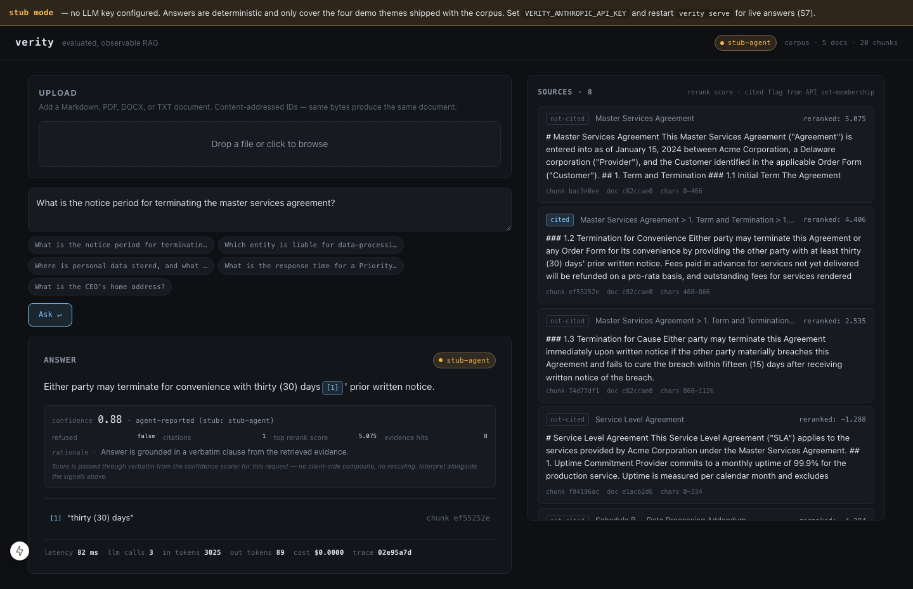
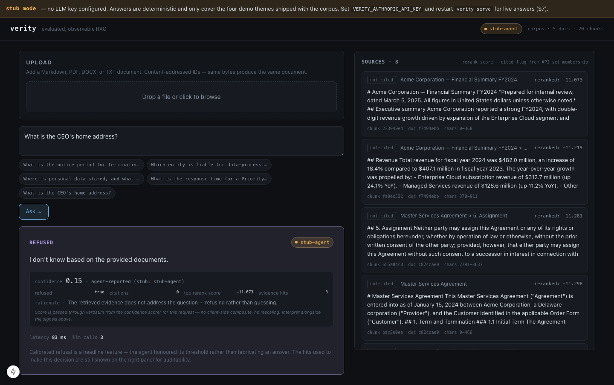

# Architecture

Verity is a staged pipeline where every stage is a typed protocol (`verity/*/base.py`)
speaking the domain model in `verity/types.py`. Nothing crosses a stage boundary except
those frozen types, which is what makes each stage independently testable and each
metric independently attributable.

## The problem it addresses

Enterprise RAG demos answer confidently and are wrong just often enough to be
dangerous: a fluent, cited-looking answer with no real grounding is the failure that
matters for contracts, filings and policies.

Verity drafts an answer, checks deterministically that its citations cover and
match it, asks a scorer model how well the evidence supports it, and refuses when a
check fails, the scorer refuses, or the score is below a threshold. It publishes faithfulness, citation accuracy,
hallucination rate and refusal precision / recall from one live run whose
per-question audit trail is committed next to the code.

## What it looks like in the UI

**Cited answer**: click a citation and the source pane highlights the exact clause.
The confidence readout shows the scorer's self-reported score, the rerank scores and
the evidence hits. A provenance badge names the model that answered.



**Refusal**: for questions the corpus does not cover, the agent returns *"I don't
know based on the provided documents"* with the scorer's rationale.



*Both screenshots are captures of `make demo`, which runs the scripted stub agent
offline: the badge reads `stub-agent` and the scores are the stub's canned values.*

## Diagram

```mermaid
flowchart LR
    subgraph Ingest["Ingestion"]
        docs[/"documents<br/>MD · TXT · PDF · DOCX (web untested)"/] --> parser[parser<br/>structure-aware]
        parser --> chunker[chunker]
        chunker --> embedder[BAAI/bge-small-en-v1.5]
    end

    embedder --> pg[(pgvector, default<br/>HNSW + FTS)]
    embedder --> mem[(in-memory store<br/>cosine + BM25)]

    subgraph Retrieve["Hybrid retrieval"]
        query[/"query"/] --> dense[dense search]
        query --> sparse[sparse search]
        dense --> rrf[RRF fusion]
        sparse --> rrf
        rrf --> rerank[cross-encoder<br/>ms-marco-MiniLM]
    end

    mem -.->|VERITY_STORE=memory| dense
    pg --> dense
    pg --> sparse

    subgraph Agent["Agent"]
        rerank --> decompose[decompose]
        decompose --> synthesize[synthesize<br/>+ verbatim citations]
        synthesize --> score[confidence scorer]
        score -->|below threshold or refused| refuse[REFUSE<br/>with rationale]
        score -->|otherwise| ship[Answer + citations]
    end

    subgraph Eval["Evaluation"]
        ship --> judge[LLM judge<br/>supported · citation_ok]
        refuse --> refusal[refusal metrics<br/>TP/FP/FN/TN]
        judge --> scorecard["scorecards/live-v1.1.0.json<br/>+ per-question audit"]
        refusal --> scorecard
    end

    scorecard --> readme["README results table<br/>(generated)"]
```



Each box is described stage by stage below; the decisions that cost a rework are under
[What I'd do differently](#what-id-do-differently).

## Stages

### 1. Ingestion (`verity.ingestion`)
`Parser → Chunker → Embedder`.
Structure-aware parsing (docling) preserves headings/sections so chunking follows semantic
boundaries rather than a fixed window. Chunks carry `char_start`/`char_end` offsets into
the parent document — the substrate for exact-passage citations. Embedding is a separate
protocol so chunking has no dependency on the embedding model (and CI can embed locally).

### 2. Retrieval (`verity.retrieval`)
`VectorStore` → `HybridRetriever` runs dense and sparse search → `Fusion` (RRF, 0-based
ranks) → `Reranker` (local cross-encoder). RRF avoids the score-scale mismatch between
dense and sparse; the reranker orders the top-k the agent reasons over. Each stage is a
traced span (latency, hit count).

Two `VectorStore` implementations exist:
- `PgVectorStore` (default, `VERITY_STORE=pgvector`): pgvector HNSW dense search +
  Postgres full-text search (`ts_rank` over the OR of the query's lexemes). Used by the
  API, `make demo`, every CLI command and the CI retrieval gate. The corpus is synced
  on first use. A document's id comes from its path (or URL, or upload digest) and stays
  the same across edits; its text's SHA-256, its chunk ids and the embedding model are
  compared with what the store holds. A match is skipped without embedding; a mismatch
  replaces all of the document's chunks in one transaction, so an edit never leaves an
  old chunk retrievable; a document whose file left the corpus directory is deleted
  with its chunks.
- `InMemoryVectorStore` (`VERITY_STORE=memory`, `--store memory`): cosine dense search +
  BM25 (`rank-bm25`). Used by the unit tests and wherever no database is available.

BM25 and `ts_rank` are different sparse scorers. `tests/integration/test_sparse_parity.py`
measures them on the 19 eval questions: the gold chunk is in both top 5s for every
answerable question, and the top hit agrees on 17 of 19.

### 3. Agentic RAG (`verity.agent`)
`QuestionDecomposer → (multi-step retrieve) → synthesize with citations → ConfidenceScorer`.
Simple questions pass straight through (single sub-question); complex ones decompose,
retrieve per sub-question, and combine evidence. Synthesis emits inline citations mapped to
exact passages. **Refusal** is decided in order: no citation, then the deterministic support
check (`verity.agent.support`: injection markers, citation coverage, cited relevance), then
the confidence scorer and its threshold. The scorer cannot override the checks before it. The prompts live in
`prompts/*.prompt`, read by a local parser (`verity.llm.prompt`, ADR 0005).

### 4. LLM runtime (`verity.llm`)
`LLMClient` per provider behind a `RoutingClient` with ordered fallback. Fallback on
transient/availability errors; **short-circuit on authentication errors** (a bad key is a
config bug, not a fallback trigger) — same decision as PromptLang's RoutingClient.

### 5. Observability (`verity.observability`)
Every stage opens a `StageSpan` bound to the query's `trace_id`: latency, token/cost usage,
hit counts and scores. Spans go to an in-process ring buffer (`RingBufferSpanExporter`, the
newest `VERITY_TRACE_MAX_SPANS`, default 10 000) that backs `/metrics` and the dashboard.
With `VERITY_OTEL_ENDPOINT` set and the `otlp` extra installed (`uv sync --extra otlp`),
spans are also sent to that collector through a batching processor; with the endpoint set
and the extra missing, startup logs the warning `otlp_export_disabled`. Logs are structured
(structlog) and carry `trace_id` on every line; under the API also `request_id` and the
authenticated principal. Each request ends with one line: `answer_done` carries the
decision (answered or refused), the refusal reason, per-stage latency, tokens and cost;
`answer_failed` carries `decision=error`, the error kind, the latency of the stages
reached, and the tokens and cost of the LLM calls that returned before the failure.

### 6. Evaluation (`verity.eval`)
Runs the whole agent over the labeled dataset and emits a `Scorecard` saved as JSON with
the git SHA. In CI the agent and the judge are scripted stubs (a pipeline smoke test); the
headline scorecard comes from one live run. `FileRunStore` keeps runs as JSON files for
`verity eval compare`. Definitions: `docs/evaluation-methodology.md`.

## The seams that matter

| Concern | Isolated behind | Why |
|---|---|---|
| Vector DB choice | `VectorStore` | swap pgvector→Qdrant without touching the pipeline (ADR 0002) |
| Prompt files | `verity.llm.prompt` | callers depend on `PromptTemplate.render` only |
| Provider choice | `LLMClient` / `RoutingClient` | add/remove providers without agent changes |
| Refusal policy | `ConfidenceScorer` | one threshold in one place, measured by the refusal metrics |

## Data flow (one query)

```
question
  └─ tracer.stage("decompose") ─ QuestionDecomposer → [sub-questions]
       └─ per sub-question:
            tracer.stage("retrieve") ─ Retriever → dense+sparse → RRF → rerank → hits
       └─ tracer.stage("synthesize") ─ LLM → draft answer + citations
       └─ tracer.stage("confidence") ─ ConfidenceScorer → Confidence
            ├─ score ≥ threshold and not refused → Answer(text, citations, hits_used, usage)
            └─ score <  threshold, or scorer refuses → Answer(refused=True, "I don't know", rationale)
```

Every stage contributes to `usage` (tokens, cost, latency) and to the trace, so the same
run yields the user's answer, the observability data, and the eval inputs.

## What I'd do differently

Each item is a decision recorded in an ADR, or a limit stated in
[`SYSTEM_CARD.md`](SYSTEM_CARD.md) or [`THREAT_MODEL.md`](THREAT_MODEL.md), that cost a
rework or still costs trust.

- **Write the ADR after the spike, not before.** ADR 0004 committed the prompts to
  PromptLang before any integration existed; it never did, the docs carried a disclaimer
  until ADR 0005 superseded it with the 140-line parser that was there all
  along. ADR 0002 named "scorecard history" as Postgres data, which was never built; its
  amendment records the JSON files that were.
- **Build the eval set before the claim.** ADR 0003 called the refusal "calibrated"
  while nothing measured calibration, and an external audit had to take the word back
  (C21 is roadmap). The 0.55 threshold and the support-check thresholds were chosen on
  the same 16 questions the v1.0.0 run reports on. A frozen dev/test split and a judge checked
  against human labels (C27, C28) come first; a headline number comes after.
- **Instrument for the SLOs from the first endpoint.** The code emits per-stage spans
  but no end-to-end latency series and no error counter, so the SLOs in the system card
  are measured from log lines. A request-level span and an `answer_failed` counter
  cost a few lines when the router was written. Likewise readiness: `/health` shipped
  checking no dependency, and only the runbook exposed it; `/ready` is separate.
- **Apply a defence to every input of its kind, with one test over all of them.** The
  untrusted-content delimiters cover the three serving prompts; the eval judge prompt,
  which reads the same documents, was left out, and the test enumerates prompt names
  instead of reading the `prompts/` directory.
- **Decide the access model in the schema.** Single tenancy is stated in SECURITY.md and
  ADR 0006 but not in the data: `documents` has no owner, uploads are not logged with
  the key that made them, and no endpoint deletes a document. Recording the uploader and
  a delete path at the first migration would have made corpus poisoning recoverable.
- **Use the secret type for every credential.** Provider and API keys are `SecretStr`;
  the Postgres DSN, password included, stayed a plain string.

## Stack

Python 3.12 · FastAPI · Postgres + pgvector (or an in-memory store) · local
embeddings and cross-encoder reranker (offline, no keys) · Anthropic and OpenAI
clients behind an ordered fallback router · OpenTelemetry spans (in-process) +
structlog · Next.js 15 UI. Tooling: uv · ruff · mypy strict · vulture · deptry ·
pytest · GitHub Actions. Eval history is kept as versioned JSON files.
